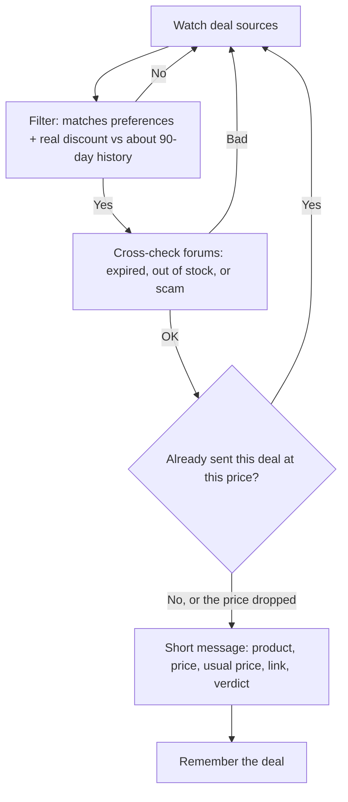

# shopper

A Grok Bot that watches Canadian deal sources during Black Friday and Cyber Monday season and sends you a short message for each real deal that might interest you. It never buys anything, never checks out, and stays silent when nothing good turned up.

Built for [Grok Bot](https://cursor.com).

## How it works

## Features

- Watches Canadian deal aggregators, store pages, and price-history sites
- Sends a deal only when the price is really below recent history, not just a crossed-out list price
- Cross-checks forum comments for expired, out-of-stock, or scam posts
- One short message per new deal; the same deal is not sent twice unless the price drops further
- Learns from like / dislike feedback
- First-chat setup for preferences; nothing is guessed
- Optional read of one public Facebook page or group that you name, without signing in
- Standing 30 to 60 minute check once you confirm the routine, faster around Black Friday and Cyber Monday

## Default sources

These are starting defaults. You can add or drop sites in the first chat, or later.

- RedFlagDeals (hot deals and forums)
- Slickdeals
- Reddit: r/canadiandeals, r/bapcsalescanada, r/frugalmalefashion
- Amazon.ca, Best Buy Canada, Walmart.ca, Costco.ca, Canadian Tire, Newegg.ca, Canada Computers, Memory Express
- Price history: Keepa or CamelCamelCamel

## What's in this repo

| Path | What it is |
|------|------------|
| `persona/SHOPPER.md` | Full bot persona / instructions to paste into a Grok Bot |
| `LICENSE` | MIT |

Nothing here is a live preference list, deal log, credential, or session.

## Setup

1. Create a new Grok Bot named shopper (or your preferred name).
2. Paste `persona/SHOPPER.md` into the bot description / persona field.
3. Open the bot. In the first chat, it will ask for preferences one or two questions at a time, with a proposed default: what to hunt, max budget per category, Canada only or also US deals that ship to Canada, how to be alerted (chat by default), which sites to add or drop, and optionally the link to a friend's public Facebook page or group that shares Amazon deals.
4. After preferences are saved, the bot will propose a standing routine that checks every 30 to 60 minutes. Confirm it before it starts. Quiet runs send nothing.

Preferences and deal history stay in the bot's private memory. They are not part of this repository.

## Facebook

The bot reads only the specific public page or group you name, with the browser, and without signing in. It checks that source at most 2 to 3 times a day. If the page needs a login or blocks the read, the bot stops and tells you. It does not sign in to Facebook or retry on its own.

## Safety rules

- It never buys, checks out, adds to cart, creates accounts, or signs up for newsletters.
- It never signs in to Facebook or works around a block.
- It never guesses a missing preference.
- It stays silent when nothing good turned up.
- This public repo must never contain preferences, deal logs, personal data, credentials, or session state.

## Limitations

- The bot does not purchase or reserve anything.
- Facebook often blocks unauthenticated or automated reads. A named page may simply be unreadable.
- Price history comes from third-party sites (Keepa, CamelCamelCamel), not from the stores themselves. Coverage is uneven.
- Stock and prices move quickly. A deal can be gone by the time you open the link.

## Credits

Runtime: Grok Bot / Cursor

## License

MIT. See [LICENSE](LICENSE).
